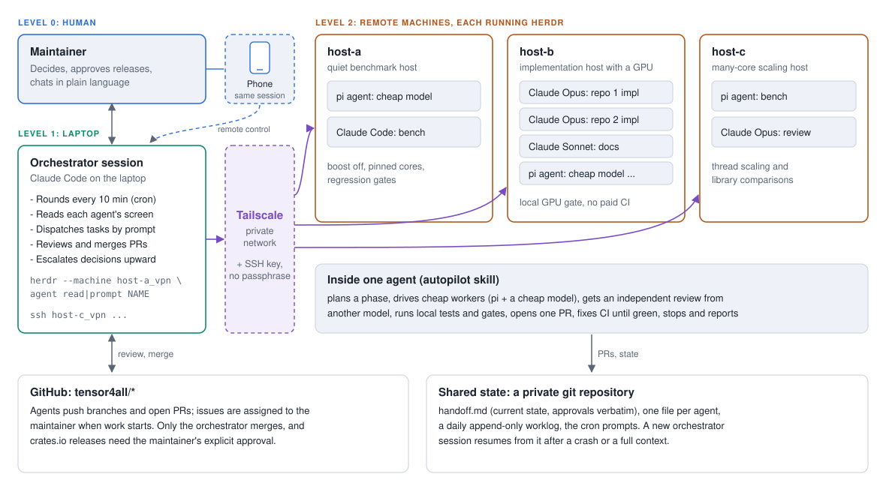

# Running a Two-Level Agent Fleet

This page describes how the maintainer runs many coding agents at once, and
how to reproduce the setup. It is a guide, not a rule. Adapt it to your own
machines and budget.



## Architecture

The fleet has three levels.

- **Level 0: the human.** The maintainer decides, approves releases and gives
  instructions in plain language. They talk only to the orchestrator. The
  orchestrator session can also be continued from Claude Code on a phone, so
  the maintainer can steer the fleet while away from the laptop. It is the same
  session, not a second one.
- **Level 1: the orchestrator.** One Claude Code session on a laptop. It runs
  rounds on a cron schedule, reads each agent's screen, dispatches tasks by
  prompt, reviews and merges pull requests, and escalates decisions it should
  not take.
- **Level 2: the machines.** Each remote machine runs
  [herdr](https://github.com/herdrdev/herdr), a terminal multiplexer for
  coding agents, with several agents in its panes. Agents are Claude Code
  sessions (Opus or Sonnet) or pi agents on cheaper models such as DeepSeek.

Two shared services tie the levels together.

- **GitHub.** Agents push branches and open pull requests. Issues are assigned
  to the maintainer when work starts. Only the orchestrator merges.
- **A private state repository.** A small git repository holds the recovery
  state, so a new orchestrator session can take over at any time. See
  [Recovery state](#recovery-state).

Each machine has a role. In the maintainer's fleet these are a quiet benchmark
host, an implementation host with a GPU, and a many-core scaling host. Adding a
machine adds a whole team of agents.

## Reproduce the setup

### 1. Network

Install [Tailscale](https://tailscale.com/) on the laptop and on every machine.
The machines then reach each other on a private network and need no open ports
on the public internet.

### 2. SSH key

Create one dedicated ed25519 key without a passphrase. The orchestrator works
unattended, so it cannot type a passphrase.

```sh
ssh-keygen -t ed25519 -N "" -f ~/.ssh/id_ed25519_fleet -C fleet
```

Add the public key to `~/.ssh/authorized_keys` on each machine. Use this key
only for the tailnet. Give each machine a Host alias in `~/.ssh/config` on the
laptop:

```sshconfig
Host host-a_vpn
    HostName host-a.your-tailnet.ts.net
    User you
    IdentityFile ~/.ssh/id_ed25519_fleet
    IdentitiesOnly yes
```

Check that `ssh host-a_vpn true` works without any prompt.

### 3. herdr

Install [herdr](https://herdr.dev) (0.9.5 when this page was written) on each machine and start it there. On the laptop, register each
machine once:

```sh
herdr machine add host-a_vpn
herdr machine list
```

Adding and removing machines is the human's job. The orchestrator only uses
machines that are already registered.

### 4. Orchestrator commands

The orchestrator drives every machine with `herdr --machine <label> ...`. The
commands it needs are few.

| Command | Use |
|---|---|
| `herdr --machine host-a_vpn agent list` | List the agents and their state. |
| `herdr --machine host-a_vpn agent get <name>` | Show one agent's details. |
| `herdr --machine host-a_vpn agent read <name>` | Read the agent's screen. |
| `herdr --machine host-a_vpn agent prompt <name> "..."` | Send a task or an answer. |
| `herdr --machine host-a_vpn agent send-keys <name> ...` | Send raw keys (Esc, Enter, Shift+Tab). |
| `herdr --machine host-a_vpn agent start ...` | Start a new agent in a pane. |
| `herdr --machine host-a_vpn agent rename <pane> <name>` | Name an agent. |
| `herdr --machine host-a_vpn pane split ...` | Make room for another agent. |

Run `herdr --help` on your version for the exact arguments.

A failed connection does not mean that a prompt was not delivered. Read the
agent's screen before you send it again.

### 5. Agent names

Name every agent `<machine>-<repo>-<role>[-<model>]`, for example
`host-b-tenferro-impl` or `host-c-t4a-review-dsv4f`. Use lowercase letters,
digits, `-` and `_`, and at most 32 characters. Claude agents may omit the
model suffix. Names disappear when an agent exits, so check them on every
round. Refer to agents by name, never by pane id.

### 6. Claude Code agents

Start Claude agents with:

```sh
claude --allow-dangerously-skip-permissions --model opus    # or sonnet
```

herdr does not apply your shell aliases, so pass the flags in full. When the
agent starts, accept the bypass dialog, then press Shift+Tab until the status
line shows that bypass permissions is on.

### 7. pi agents

[pi](https://github.com/earendil-works/pi) runs agents on cheaper models. Two
things differ from Claude Code.

- A prompt sent while the agent is in a long tool call is queued. It runs only
  after the tool call ends. For an urgent prompt, send Esc first, then the
  prompt and Enter.
- The screen shows little history. Read the session log instead, in
  `~/.pi/agent/sessions/*/*.jsonl` on that machine.

### 8. Model policy

Use Sonnet or a cheap model for simple work: docs, mechanical edits, running
benchmarks, collecting logs. Use Opus for complex coding, reviews and
judgment calls. The orchestrator itself runs on the strongest model you have.

## Orchestrator operating rules

These are the rules the maintainer's orchestrator follows. Write your own
version into the orchestrator's instructions.

- **Rounds.** Run a round every 10 minutes: read every agent, unblock or
  redirect, merge what is ready. Twice an hour, check overall progress against
  the TODO queue.
- **Issue patrol.** Once an hour, scan the tracked repositories for new issues
  and comments.
- **Daily checks.** Update the tools (Claude Code, pi, herdr and build caches)
  on every machine. Read the issue trackers of upstream projects you depend on.
- **Approval dialogs.** Never answer an agent's approval dialog on its behalf.
  Report it to the human instead. The only exceptions are dialogs agreed in
  advance, such as folder trust, a model switch, or accepting bypass
  permissions at startup.
- **Releases.** Publish to crates.io only after the maintainer approves that
  release explicitly in the conversation.
- **GPU work.** Validate tenferro GPU changes on a local GPU and mark the PR
  with a label, instead of running paid GPU CI.
- **Issue assignment.** When an agent starts on an issue, assign it to the
  maintainer. This avoids duplicate work with outside contributors.
- **Merging.** Use a merge commit when the branch contains other people's
  commits, so their authorship is kept.
- **Benchmarks.** Measure on a quiet host with CPU boost off. See
  [`rules/benchmark`](../../rules/benchmark/index.md).
- **Approvals.** Record every approval verbatim, with its date, in the
  handoff file.

## Recovery state

A long orchestrator session dies or fills its context sooner or later. The
recovery state lets a fresh session take over in a few minutes. Keep it in a
private git repository that every machine can push to.

```text
state/<project>/
  handoff.md            written only by the orchestrator
  monitoring.md         the exact cron prompts and schedules
  agents/<name>.md      each agent writes only its own file
  worklog/<date>.md     append-only, anyone
```

- `handoff.md` is rewritten, not appended, on every change. It lists the
  machines, the agents and their tasks, in-flight PRs, tracked issues, pending
  decisions, approvals (verbatim, with dates), standing rules, and the ordered
  TODO queue.
- `agents/<name>.md` holds one agent's task, branch and worktree, last step,
  next step and blockers. One writer per file means agents on different
  machines never conflict.
- `worklog/<date>.md` records dated events: merges, releases, decisions with
  their source, incidents.
- `monitoring.md` holds the exact cron prompts, so a new session can recreate
  the loops without guessing.

To resume after a crash or a full context:

1. Read `handoff.md`, then every `agents/*.md`, then the last two worklog
   files.
2. Check each listed agent with `agent get` and `agent read`, and each listed
   PR, before acting. The files can be one update behind.
3. Recreate the cron loops from `monitoring.md`.

## How the maintainer's rule set is built

The maintainer's own rules are private, but their structure is easy to copy.
There are four layers.

1. **Global instructions** in `~/.claude/CLAUDE.md`. Personal preferences that
   hold in every project: the response language, preferred tools (for example
   CodeGraph before grep), and limits on remote control (which herdr commands
   the session may run, and that it never answers another agent's approval
   dialog).
2. **Per-repository `AGENTS.md`.** Each tensor4all repository keeps a short
   `AGENTS.md` that points to this repository for shared rules and adds only
   repository-specific ones.
3. **Claude Code auto-memory.** A memory directory with one fact per file and
   an index file that lists them all, one line each. Each fact has a type:
   user, feedback, project or reference. Feedback and project entries carry a
   "Why" line and a "How to apply" line, so the rule can be judged later
   rather than followed blindly.
4. **A private advisor repository.** It holds:
   - **Skills.** An `autopilot` skill runs one issue or phase alone. It plans
     the phase, drives cheap workers through pi with helper scripts (a
     supervisor such as `supervise.sh` and a worker launcher such as
     `pi_worker.sh`), gets an independent review from a different model, opens
     one PR and fixes CI until it is green. A `build-profile` skill builds the
     decision profile below.
   - **A decision profile.** `profile/rules.md` holds rules, and a precedents
     file holds short past decisions with a pointer to their source. The
     `build-profile` skill mines past transcripts and worklogs for decisions
     that recur, and turns them into rules. Rules that came from the
     maintainer directly are never weakened by a rebuild.
   - **Proxy logs.** Every decision the autopilot takes on the maintainer's
     behalf is logged. The maintainer reviews and corrects them, and the
     corrections feed the next profile update.
   - **The `state/` directory** described in [Recovery state](#recovery-state).

Start small. A global `CLAUDE.md`, an `AGENTS.md` per repository and the state
directory are enough for a fleet of a few agents. Add the profile when you
notice that you answer the same questions again and again.

## Security notes

- A passphrase-less key and bypass permissions are acceptable only on machines
  you control, inside the tailnet. Do not reuse the key elsewhere.
- Keep secrets out of every file an agent can read: the state repository,
  worklogs, memory and prompts. Agents copy what they see into logs and PRs.
- On a shared machine, other users' jobs come first. Check the load before
  starting builds or benchmarks, limit the cores your agents use, and never
  kill processes you do not own.
